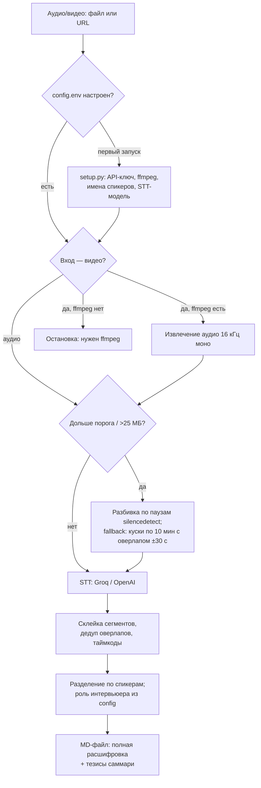

# AI-Transcribe — транскрибация аудио и видео созвонов/интервью

Скилл для Hermes Agent: расшифровка записей разговоров (интервью, созвоны, подкасты) через Groq Whisper или OpenAI STT — с разбивкой по паузам, разделением спикеров и итоговым MD-файлом с тезисами.

## Что делает

- **Предконфигурация**: `setup.py` проверяет API-ключ (Groq/OpenAI), ffmpeg/ffprobe, имена и роли спикеров, модель STT; сохраняет `config.env`
- **Подготовка**: извлечение аудио из видео (16 кГц моно), замер длительности
- **Разбивка**: длинные записи режутся по тишине (`silencedetect`), fallback — куски по 10 минут с оверлапом ±30 секунд и дедупом при склейке
- **Распознавание**: чанки уходят в STT-провайдер; склейка с таймкодами
- **Спикеры**: реплики разводятся по собеседникам, интервьюер берётся из config
- **Выдача**: MD-файл полной расшифровки + саммари тезисами

## Схема алгоритма



## Триггеры

«Расшифруй созвон/интервью/запись», «сделай транскрипт аудио», голосовое резюме встречи.

## Требования

- Python 3.8+ (requests), ffmpeg/ffprobe для видео и длинных записей
- API-ключ `GROQ_API_KEY` или `OPENAI_API_KEY` (в env/config, не в репозитории)

## Установка

```bash
git clone https://github.com/vfedeev/ai-skills.git
cp -r ai-skills/ai-transcribe ~/.hermes/skills/
# первый запуск: python3 ~/.hermes/skills/ai-transcribe/scripts/setup.py
```

## Быстрый старт

Пришли Hermes путь или ссылку на запись и скажи «расшифруй с разделением по спикерам». Скилл сам спросит имена собеседников, если их нет в `config.env`.
