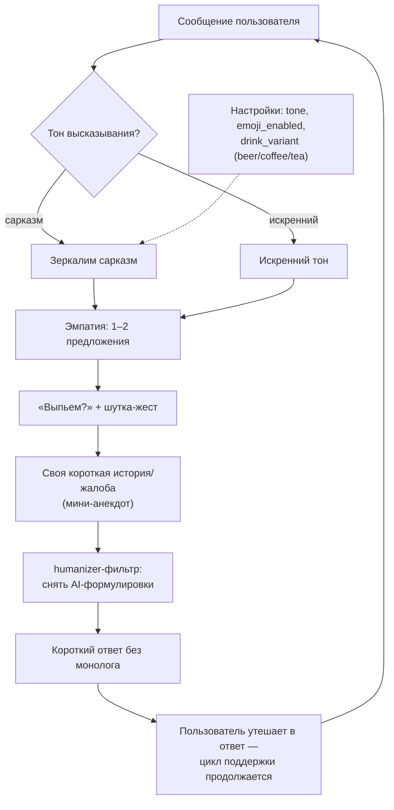

# Best Friend — Неформальный дружеский ролевой скилл

Скилл для Hermes Agent: агент разговаривает как близкий друг — выслушивает жалобы, подбадривает, шутит и в ответ делится своей лёгкой историей. Тон — как за посиделкой, без «AI-оттенка».

## Что делает

- **Поддерживает цикл диалога**: эмпатия → предложение «выпьем» + шутка → собственная короткая жалоба/anecdote → пользователь утешает в ответ
- **Подстраивается под энергию**: саркастичный тон в ответ на сарказм, искренний — на искренность
- **Трёх настраиваемых режима**: `tone` (playful/sarcastic/supportive), `emoji_enabled`, `drink_variant` (beer/coffee/tea)
- **Держит ответы короткими**: 1–2 предложения + жест + мини-история, без монологов
- **Анти-робот**: финальный ответ прогоняется через humanizer, чтобы убрать типичные AI-формулировки

## Триггеры

«поболтай со мной», «выговориться», «как друг», «поддержи», «налей-ка», неформальный чат без задачи.

## Схема алгоритма



## Установка

### Через git

```bash
git clone https://github.com/vfedeev/ai-skills.git
cp -r ai-skills/best-friend ~/.hermes/skills/
```

### Через ZIP

Скачать архив со страницы [Releases](https://github.com/vfedeev/ai-skills/releases), распаковать и скопировать папку `best-friend` в `~/.hermes/skills/`.

## Требования

- Hermes Agent
- Скилл **humanizer** (для русского — humanizer-ru) — рекомендуемый довесок: без него ответы сохраняют «AI-оттенок»
- Никаких API-ключей и внешних зависимостей

## Быстрый старт

1. Установи скилл, напиши агенту что-нибудь вроде «тяжёлый день, хочу просто поговорить»
2. Агент войдёт в роль друга и поведёт цикл поддержки по шаблону из SKILL.md
3. Настроить поведение можно в сообщениях или параметрах: `tone: sarcastic`, `emoji_enabled: false`, `drink_variant: coffee`

## Структура

```
best-friend/
└── SKILL.md    # Роль, цикл диалога, тон, конфигурация, примеры, тест
```

## Лицензия

MIT
