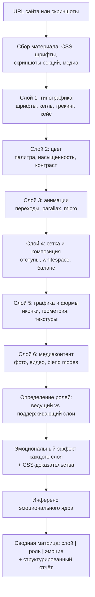

# UltraUI Layers — Разбор сайта по 6 слоям

Скилл для Hermes Agent: визуальный анализ сайтов по методу Ultra UI (Евгений Кузьмин/Апрок).

## Что делает

- **Разбирает** любой сайт по 6 стилеобразующим слоям
- **Определяет** ведущие и поддерживающие слои
- **Выдаёт** структурированный отчёт с CSS-доказательствами и эмоциональным эффектом

### 6 слоёв Ultra UI

| # | Слой | Что анализируем |
|---|------|----------------|
| 1 | Типографика | Шрифты, кегль, начертания, трекинг, кейс |
| 2 | Цвет | Палитра, насыщенность, контраст |
| 3 | Анимации | Переходы, parallax, microinteractions |
| 4 | Сетка и композиция | Сетка, отступы, whitespace, баланс |
| 5 | Графика и формы | Иконки, декор, геометрия, текстуры |
| 6 | Медиаконтент | Фото, видео, иллюстрации, blend modes |

## Схема алгоритма



## Установка

### Через git

```bash
git clone https://github.com/vfedeev/ai-skills.git
cp -r ai-skills/ultraui-layers ~/.hermes/skills/
```

### Через ZIP

Скачать архив со страницы [Releases](https://github.com/vfedeev/ai-skills/releases), распаковать и скопировать папку `ultraui-layers` в `~/.hermes/skills/`.

## Использование

1. Пришлите Hermes URL сайта или скриншот
2. Скажите: «Разбор по слоям», «UI-аудит», «Проанализируй стиль»
3. Hermes загрузит скилл, извлечёт CSS/контент и выдаст структурированный отчёт

### Пример вывода

```
🔍 UltraUI-разбор: example.com

Тип: Лендинг SaaS-продукта
Эмоциональное ядро (инференс): Технологичность, минимализм, доверие

📊 Сводная матрица

| Слой | Роль | Эмоция |
|------|------|--------|
| Типографика | ⭐ Ведущий | Монументальность |
| Цвет | 🔸 Поддерживающий | Сдержанность |
| ... | ... | ... |
```

## Требования

- Модель с vision (для анализа скриншотов)
- Доступ к интернету (для извлечения CSS/контента)

## Структура

```
ultraui-layers/
├── SKILL.md              # Основной скилл (алгоритм + шаблон вывода)
├── README.md             # Этот файл
└── references/
    └── ultraui-layers.md # Детали по 6 слоям
```

## Лицензия

MIT
