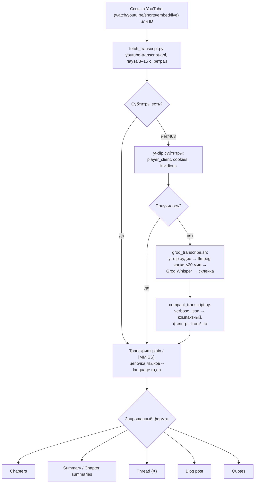

# YouTube Content — транскрипты YouTube в готовые форматы

Скилл для Hermes Agent: достаёт субтитры/транскрипт из любого YouTube-видео и превращает их в главы, саммари, тред, блог-пост или цитаты. Трёхуровневый конвейер: локальный скрипт → yt-dlp субтитры → Groq Whisper для видео без субтитров.

## Что делает

- **`fetch_transcript.py`** — транскрипт по любой форме ссылки (watch, youtu.be, shorts, embed, live, сырой 11-символьный ID); JSON, plain text, с таймкодами или компактный `[MM:SS]`; цепочка языков через `--language ru,en`
- **`groq_transcribe.sh`** — конвейер «в одну команду» для видео **без** субтитров: yt-dlp качает аудио → ffmpeg режет на чанки ≤20 мин (лимит Groq ~25MB) → Groq Whisper распознаёт → склейка в чистые `[MM:SS]` строки
- **`compact_transcript.py`** — сжатие verbose_json Groq в компактный формат + фильтрация по диапазону времени (`--from 48:00 --to 80:00`)
- Форматирование по запросу: **Chapters / Summary / Chapter summaries / Thread (X) / Blog post / Quotes** — каждую логическую абзац-строку с новой строки
- Встроенная защита от YouTube 429: рандомизированная пауза 3–15 с перед запросом, ретраи, фолбэки

## Триггеры

- Пользователь прислал ссылку на YouTube / «сделай саммари видео», «достань транскрипт», «собери тред/статью по видосу»
- Любая задача «видео → текст → форматированный контент»

## Схема алгоритма



## Комплект

| Файл | Назначение |
|---|---|
| `scripts/fetch_transcript.py` | основнойFetcher через youtube-transcript-api (v1.x) |
| `scripts/groq_transcribe.sh` | STT-конвейер для видео без субтитров (yt-dlp + ffmpeg + Groq) |
| `scripts/compact_transcript.py` | verbose_json → `[MM:SS]`, фильтр по времени |
| `references/output-formats.md` | шаблоны всех форматов выдачи |
| `references/yt-dlp-tips.md` | обходы 403: cookies, player_client, invidious |

## Требования

- Python 3.8+ + `youtube-transcript-api` (в приватном `.venv/` рядом с SKILL.md; на новой машине пересоздаётся: `uv venv .venv && uv pip install --python .venv/bin/python youtube-transcript-api`)
- Для Groq-конвейера: `yt-dlp`, `ffmpeg`, `curl`, ключ `GROQ_API_KEY` в `~/.hermes/.env` (никогда не хранится внутри скилла)

## Установка

```bash
git clone https://github.com/vfedeev/ai-skills.git
cp -r ai-skills/youtube-content ~/.hermes/skills/
```

## Быстрый старт

```bash
SD=~/.hermes/skills/youtube-content

# транскрипт с таймкодами
$SD/.venv/bin/python $SD/scripts/fetch_transcript.py "https://youtu.be/VIDEO_ID" --compact

# видео без субтитров → полный транскрипт
bash $SD/scripts/groq_transcribe.sh "https://youtu.be/VIDEO_ID" /tmp/transcript.txt ru

# вырезать практическую часть 48:00–80:00
python3 $SD/scripts/compact_transcript.py /tmp/transcript.json --from 48:00 --to 80:00
```

Дальше — отдать агенту нужный формат («сделай главы», «напиши тред», «саммари + цитаты»).
